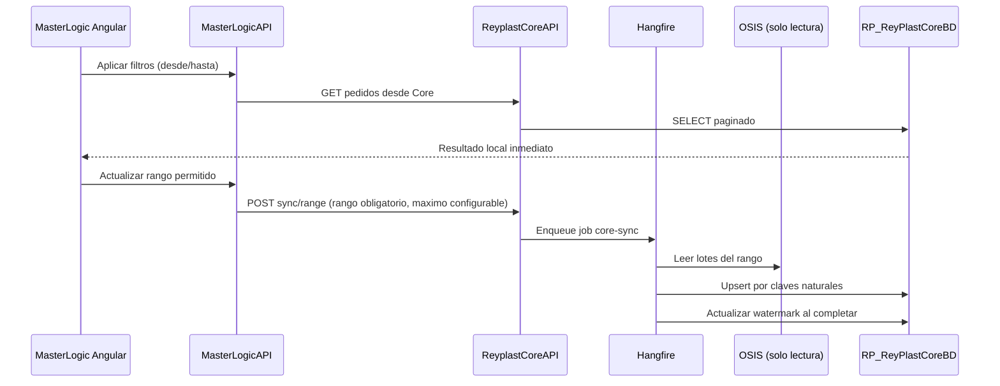
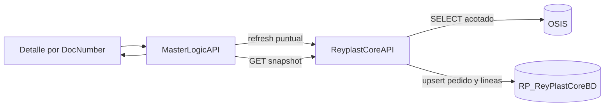
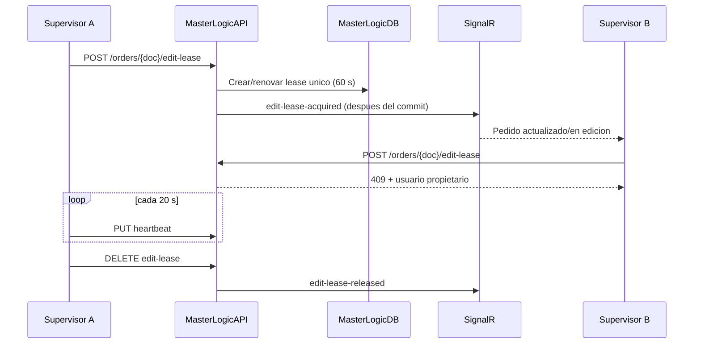

# Sincronizacion de pedidos y gestion de asignaciones

## Responsabilidades

- OSIS es solo la fuente externa de pedidos. ReyplastCoreAPI nunca escribe en OSIS.
- RP_ReyPlastCoreBD conserva la copia consultable de pedidos, lineas, canales, grupos y cantidades suspendidas.
- MasterLogicAPI conserva asignaciones, solicitudes de trabajo, avances, tiempos y leases de edicion.
- SignalR notifica cambios ya confirmados; no sincroniza OSIS ni decide concurrencia.
- Hangfire ejecuta exclusivamente trabajos acotados de sincronizacion en segundo plano.

## Flujo por rango

## Flujo puntual por pedido

La paginacion, los tabs, una asignacion, un retiro y un evento SignalR solo leen Core; no encolan sincronizaciones.

## Edicion concurrente

## Tablas de sincronizacion

Hangfire ya conserva jobs, estados, reintentos y errores en su propio esquema. Por eso, a futuro,
`SyncExecutions` puede reducirse o retirarse una vez que se eliminen sus claves foraneas desde
pedidos, lineas, productos y canales y los contratos de API devuelvan el identificador de Hangfire.

`SyncCheckpoints` no duplica Hangfire: contiene el watermark de negocio desde el que comienza el
proximo delta. Debe conservarse (o reemplazarse por una tabla pequena de cursores) aunque se quite
`SyncExecutions`. El orden seguro es:

1. dejar de exponer `SyncExecutionId` y usar `BackgroundJobId`;
2. quitar las FK de catalogos y pedidos a `SyncExecutions`;
3. mover diagnostico/reintentos al dashboard de Hangfire;
4. migrar solo el ultimo watermark valido a un cursor de sincronizacion;
5. eliminar `SyncExecutions`; renombrar `SyncCheckpoints` a `SyncCursors` si se desea aclarar su funcion.
